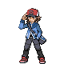
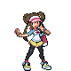
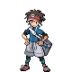

<table>
<tr>
  <!-- Left column: Welcome text -->
  <td valign="middle">
    <h1 style="font-size: 2em;">WELCOME, TRAINER!</h1>
  </td>

  <!-- Right column: GIFs -->
  <td valign="middle" align="center">
    
    
    
  </td>
</tr>
</table>

  

<h2>📝 Trainer Profile</h2>

<h3> I'm <b>Rudraksh</b>, an <b>MSc Computing (Artificial Intelligence and Machine Learning)</b> student at <b>Imperial College London</b> and an <b>ex-CS undergraduate from IIT (ISM) Dhanbad</b>, passionate about <b>Artificial Intelligence</b> and <b>Machine Learning</b>. Previously, I worked as an <b>Applied Scientist Intern</b> at Amazon and a <b>Platform Intelligence Intern</b> at Samsung Research. </h3>

<table>
  <tr>
    <th colspan="2" align="center">
      <h2>⚡ Current Quests</h2>
    </th>
  </tr>
  <tr>
    <td valign="middle">
      <ul>
        <li>Vision Transformers (ViTs)</li>
        <li>Variational Autoencoders (VAEs)</li>
        <li>Large & Small Language Models (LLMs/SLMs)</li>
        <li>Zero-Knowledge Machine Learning</li>
        <li>Federated Learning</li>
        <li>Data-Centric AI</li>
        <li>Machine Unlearning</li>
        <li>Blockchain & Healthcare AI</li>
        <li>Human-AI Interaction</li>
        <li>AGI Research</li>
        <li>Learning Optimization</li>
        <li>Multi-Agent Systems</li>
        <li>AgenticAI</li>
      </ul>
    </td>
    <td valign="middle" align="center">
      
      
        
      
      
    </td>
  </tr>
</table>

<table>
  <tr>
    <th colspan="2" align="center">
      

        <ul align="center" style="list-style: none">
          

            <h2>🏅 Gym Badges</h2>
          

        </ul>
      

    </th>
  </tr>
  <tr>
    <!-- Left column: Achievements list -->
    <td valign="middle">
      <ul>
        <li>Top 6: Amazon ML Challenge (Multimodal Regression)</li>
        <li>Winner: DeepFunding (Ethereum Ecosystem Modeling)</li>
        <li>Winner: Aleph LATAM Hackathon (AI Track)</li>
        <li>Winner: Chromion Chainlink Hackathon (Cross-Chain AMM)</li>
        <li>Winner: Warpspeed Hackathon (Agentic AI Security)</li>
        <li>Winner: Base Wallet Risk Scoring</li>
        <li>Best Overall & Stellar Track Winner: Aleph Hackathon</li>
        <li>2nd Runner-Up: HackFest ’24, IIT (ISM) Dhanbad</li>
        <li>2nd Runner-Up: Agglomeration 1.0, IIT (ISM) Dhanbad</li>
        <li>Team AIR 26: eYRC 2023–24 (Software)</li>
      </ul>
    </td>
    <!-- Right column: Pokémon GIFs -->
    <td valign="middle" align="center">
      
      
        
      
      
    </td>
  </tr>
</table>

<h2>🌐 Connect via Entralink</h2>

  
📧 <b>Email:</b> <a href="mailto:rsjoshi0505@gmail.com">Send me a PokéMail!</a> 
💼 <b>LinkedIn:</b> <a href="https://www.linkedin.com/in/rudraksh-sachin-joshi">Connect in Trainer Style</a> 
📄 <b>CV:</b> <a href="https://drive.google.com/file/d/16kBYvS35Z5nHLxbZtZMxjxCG7gGfmPjI/view?usp=sharing">Catch my Trainer Log!</a>

 

<!-- Pokémon GIF Grid -->
<table align="center">
  <tr>
    <td align="center">
      
      
      
      
      
      
      
      
      
      
      
      
    </td>
  </tr>
</table>

---

<!-- Tech Stack (center aligned) -->

  <h2>💫 Pokédex of Abilities</h2>

  <h3>🖥️ Programming Languages</h3>
  

    
  

  <h3>🏗️ Frameworks & Libraries</h3>
  

    
  

  <h3>🗄️ Databases</h3>
  

    
  

  <h3>☁️ DevOps & Cloud</h3>
  

    
  

  <h3>🛠️ Tools & Platforms</h3>
  

    
  

